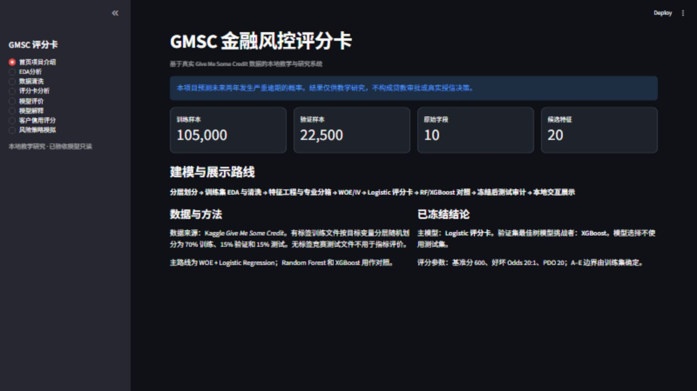
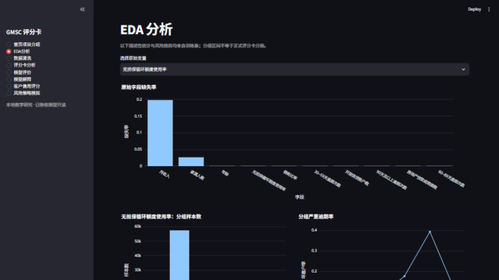
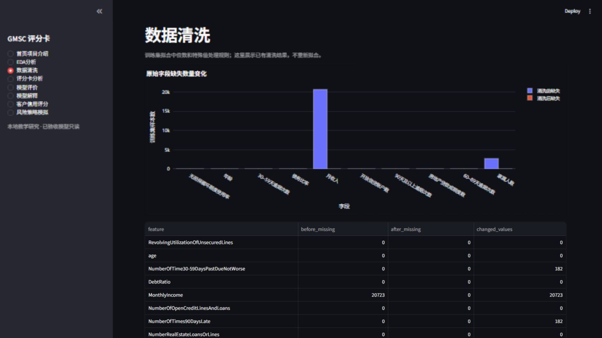
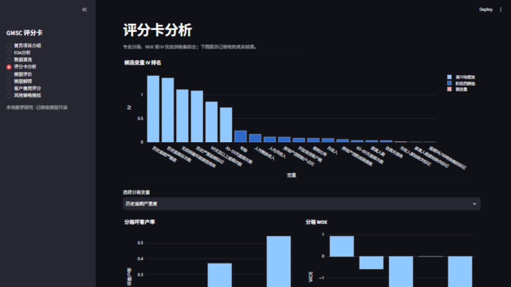
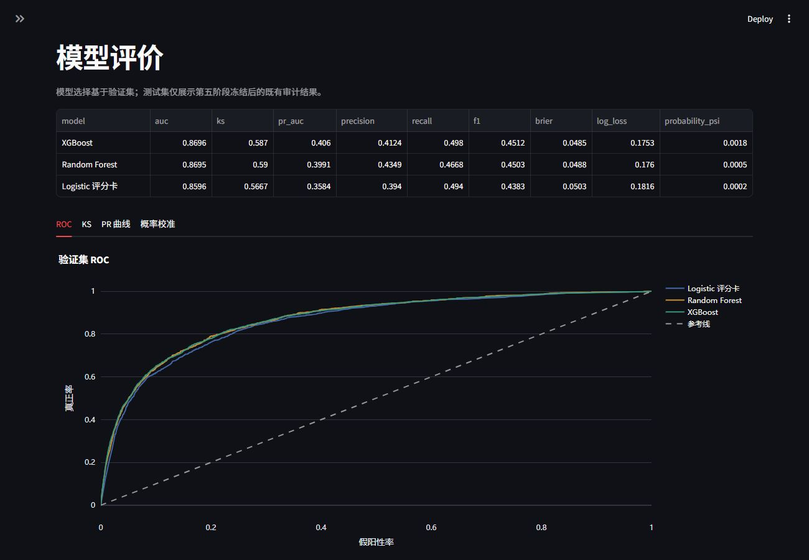
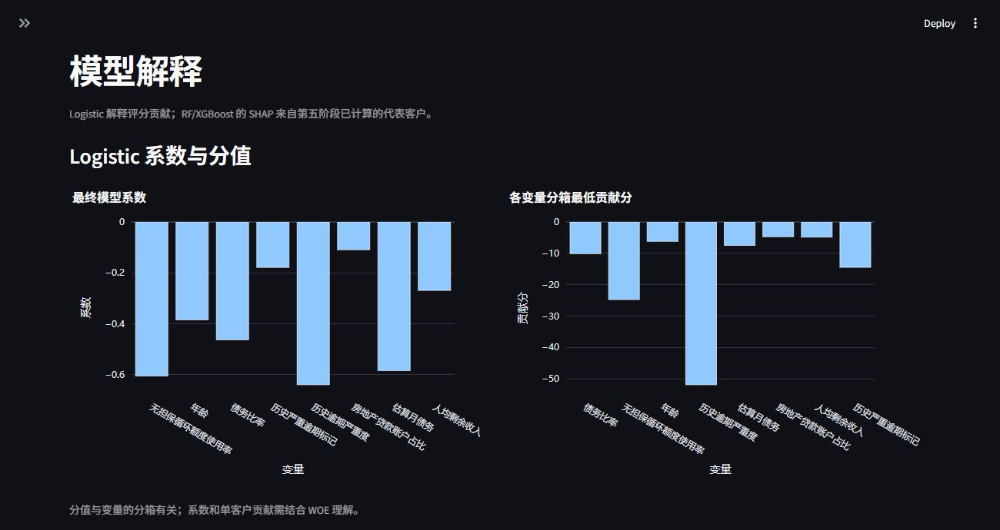
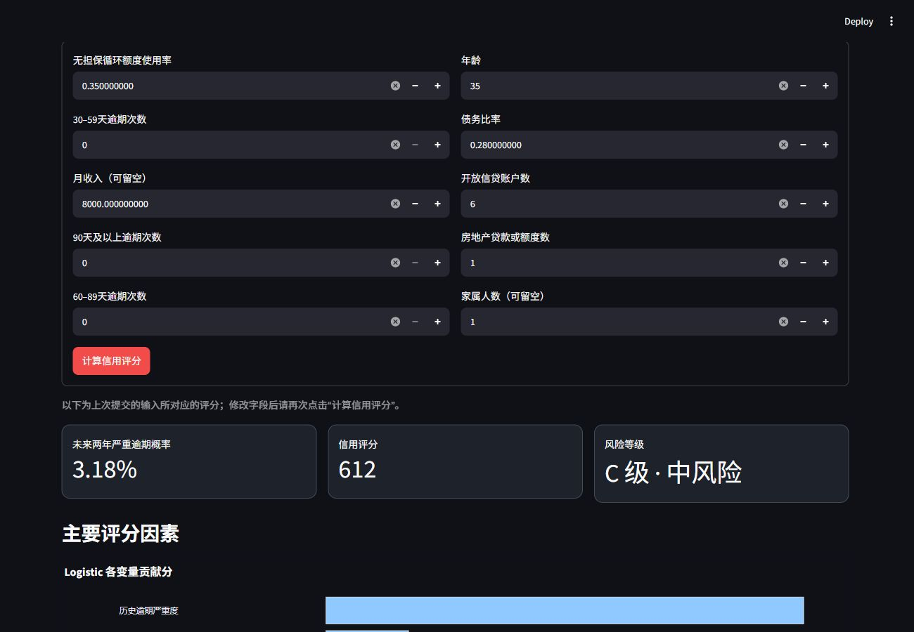
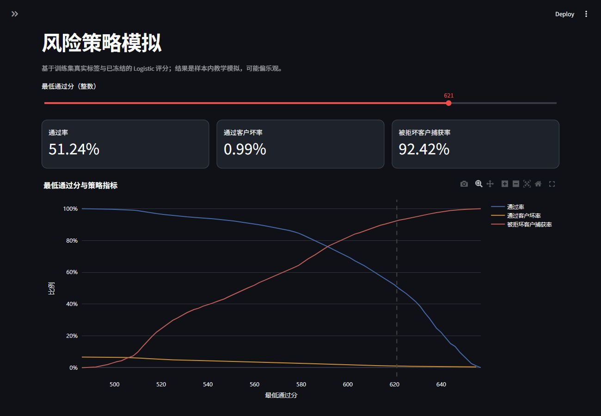

# GMSC 金融风控评分卡建模项目

基于 Kaggle **Give Me Some Credit** 数据集，完成从数据检查、评分卡建模、树模型对照到本地交互展示的七阶段项目。目标是估计客户未来两年发生严重逾期的概率（PD）。这是教学与研究项目，**不用于真实贷款审批或授信决策**。

## 项目一览

- **主路线**：训练集拟合分箱与 WOE，使用 Logistic Regression 建立可解释的 PD 评分卡。
- **对照路线**：Random Forest、XGBoost；综合比较验证集表现，并用 SHAP 解释树模型。
- **数据边界**：有标签数据按目标变量分层划分为 70% 训练、15% 验证、15% 测试。验证集用于选模；测试集只在模型与结论冻结后评价一次。
- **交付成果**：八本 Notebook、八页 Streamlit 本地应用、图表、汇总 Excel、正式报告和知识手册。七阶段已于 2026-10-18 全部通过验收。

## 七阶段开发概览

| 阶段 | 完成的工作 | 主要成果 |
| --- | --- | --- |
| 1. 项目初始化 | 建立 Python 3.11 环境、模块化目录、依赖、开发规则和基础测试。 | 可复用的项目骨架与文档。 |
| 2. EDA 与数据清洗 | 先分层划分数据，再只用训练集分析缺失、异常和风险趋势；训练集拟合清洗规则后应用到三组数据。 | 数据质量报告、图表、清洗结果与教学 Notebook。 |
| 3. 特征工程与 WOE/IV | 构造可解释的业务特征；在训练集完成专业分箱、WOE 和 IV，使用验证集做无标签稳定性检查。 | 分箱规则、特征分析表、稳定性图表与 Notebook。 |
| 4. Logistic 评分卡 | 综合筛选变量，完成训练集交叉验证与验证集方案比较；将 PD 转为 PDO 信用分和 A–E 风险等级。 | 可解释的主评分卡、评分规则和模型报告。 |
| 5. 树模型对照与解释 | 训练 RF、XGBoost，与 Logistic 比较区分能力、校准和稳定性；冻结结论后完成一次性测试集审计，并生成 SHAP 解释。 | 三模型对比、冻结审计、解释图表与 Notebook。 |
| 6. 本地交互系统 | 用 Streamlit + Plotly 展示已验收的模型与报告，提供单笔演示评分和策略阈值模拟；页面不重新训练。 | 八页只读本地网页。 |
| 7. 总结与验收 | 汇总冻结结果并交叉核对，制作正式报告、汇报稿、综合工作簿及完整案例教学材料。 | 最终交付文件与[验收清单](reports/final/第七阶段验收清单.md)。 |

术语速览：PD 是未来两年严重逾期概率；WOE/IV 用于分箱后的风险编码与单变量区分能力参考；PDO 用于把概率映射到信用分。

## Streamlit 网页：八页功能与实机截图

下列截图来自本机实际运行的应用。网页读取本地已验收产物，不在打开页面时训练模型。评分页使用**非真实演示输入**；模型解释截图避开了真实个案明细。

### 1. 首页项目介绍

概览数据划分、建模路线、主评分卡及树模型挑战者，让读者先了解系统的目标与边界。



### 2. EDA 分析

查看训练集字段缺失率，并按所选原始变量观察描述性分组的样本量和严重逾期率；这些分组不是正式评分卡分箱。



### 3. 数据清洗

对照清洗前后的缺失数量与异常处理结果，展示训练集拟合规则带来的变化。



### 4. 评分卡分析

浏览候选变量 IV 排名，切换变量检查分箱坏客户率、WOE 和最终评分卡规则。



### 5. 模型评价

对照 Logistic、RF、XGBoost 的验证集指标，切换 ROC、KS、PR 与概率校准曲线；测试集只展示冻结后的既有审计。



### 6. 模型解释

查看 Logistic 系数与分箱贡献分；页面还可读取第五阶段预先计算的 RF/XGBoost 代表样本 SHAP。截图只展示汇总图表。



### 7. 客户信用评分

输入十个原始字段后，由 Logistic 主评分卡输出 PD、信用分、风险等级和分值贡献；RF/XGBoost 仅提供 PD 对照。**截图采用非真实演示输入，显示的是已验收模型实际计算的结果，并非真实客户或授信建议。**



### 8. 风险策略模拟

拖动最低通过分，观察通过率、通过客户坏率与被拒坏客户捕获率的变化。这里使用训练集评分与标签做样本内教学模拟，结果可能偏乐观。



## 本地运行

项目使用 Python 3.11 和根目录 `.venv`。首次在 Windows 创建环境：

```powershell
py -3.11 -m venv .venv
```

安装依赖后，可双击 `启动GMSC系统.bat`，或运行：

```powershell
.\.venv\Scripts\python.exe -m pip install -r requirements.txt
.\.venv\Scripts\python.exe -m src.dashboard.launcher
```

应用只监听本机 `127.0.0.1:8501`。再次运行启动脚本会复用已有页面。克隆仓库后，仍需自行准备原始数据并运行项目阶段脚本，生成被 Git 忽略的本地模型和逐行中间产物；仅凭仓库文件不能直接运行全部页面。应用不会自动下载数据、重新训练或覆盖已验收模型。

本地阶段产物准备齐全后，运行自动化测试：

```powershell
.\.venv\Scripts\python.exe -m pytest -q
```

## 成果文件

- [正式建模报告（PDF）](reports/final/GMSC_建模总结报告.pdf) · [Word 版](reports/final/GMSC_建模总结报告.docx)
- [项目汇报稿（PDF）](reports/final/GMSC_项目汇报稿.pdf) · [综合分析工作簿](reports/excel/stage7_comprehensive_report.xlsx)
- [第五阶段仓库版工作簿](reports/excel/stage5_model_comparison_public.xlsx) · [金融风控知识手册](docs/金融风控知识手册.md)
- [八本教学 Notebook](notebooks/) · [项目决策记录](DECISIONS.md) · [开发变更记录](CHANGELOG.md)

## 数据与仓库边界

原始文件由使用者自行从 Kaggle 获取并放入 `data/raw/`：`GiveMeSomeCredit-training.csv`（或 `cs-training.csv`）、`GiveMeSomeCredit-testing.csv`（或 `cs-test.csv`）和 `Data Dictionary.xls`。无标签竞赛测试文件不用于本项目指标评价。

仓库只保留源代码、测试、教学材料和汇总成果；**不提交原始或逐行数据、真实个案明细、序列化模型、日志及密钥**。第五阶段仓库版工作簿已移除含源行号与原始特征值的个案工作表。预测与策略模拟仅供教学研究，不代表审批结论。

## 项目结构

```text
src/          正式的清洗、特征、建模、评分和展示服务
app/          Streamlit 页面
notebooks/    八本教学与实验 Notebook
reports/      汇总工作簿、图表与最终报告
docs/         知识手册与网页截图
tests/        自动化测试
data/         本地原始和阶段数据（逐行文件不入库）
models/       本地已验收模型（序列化文件不入库）
```
