# GMSC 第三阶段分箱、WOE 与 IV 业务解释

所有切点、WOE 和 IV 仅使用训练集拟合。验证集只用于无标签 PSI；测试集不参与本报告结论。
IV 与 PSI 仅作单变量初筛，最终变量选择留到第四阶段。

## 训练集 IV 排名

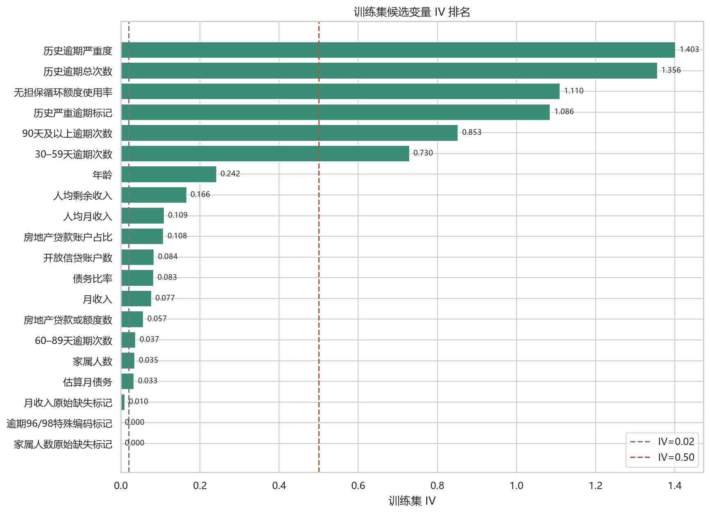

训练集最高 IV 变量为“历史逾期严重度”，IV=1.402744，初筛状态为“高IV待复核”。高 IV 不直接等同于最终入模资格。

## 验证集无标签 PSI

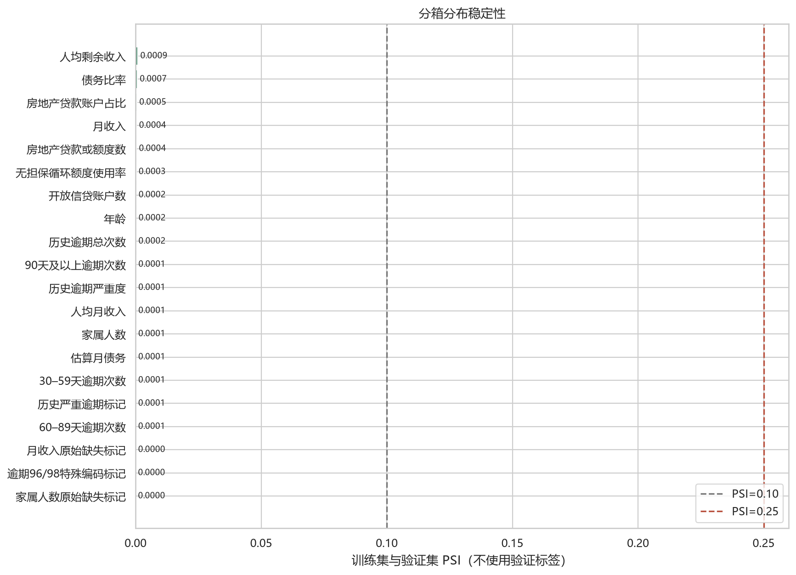

PSI 最高变量为“人均剩余收入”，PSI=0.000913，稳定性判定为“稳定”。PSI 只比较分箱占比，不使用验证集目标变量。

## WOE 高相关诊断

训练集共发现 7 对 |Spearman|≥0.70 的 WOE 候选变量；本阶段只标记，不删除变量。

## 历史逾期严重度

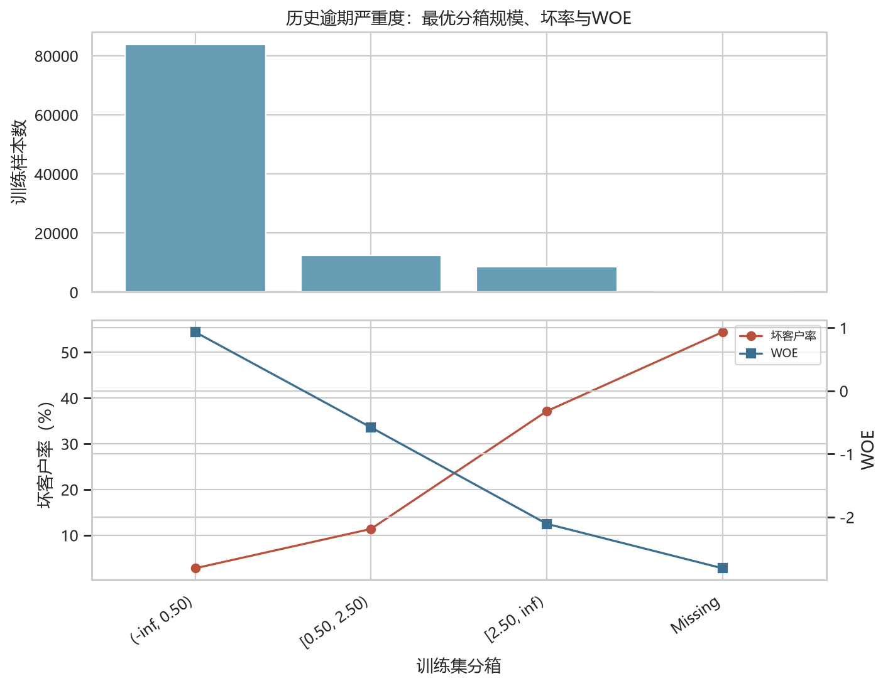

训练集有效箱共 4 个，箱坏率范围为 2.75%–54.40%；IV=1.402744，验证 PSI=0.000125。

初筛结论：高IV待复核。检查数据泄露、特殊编码和变量重复后再决定。分箱关系是统计关联，不代表因果或真实授信结论。

## 历史逾期总次数

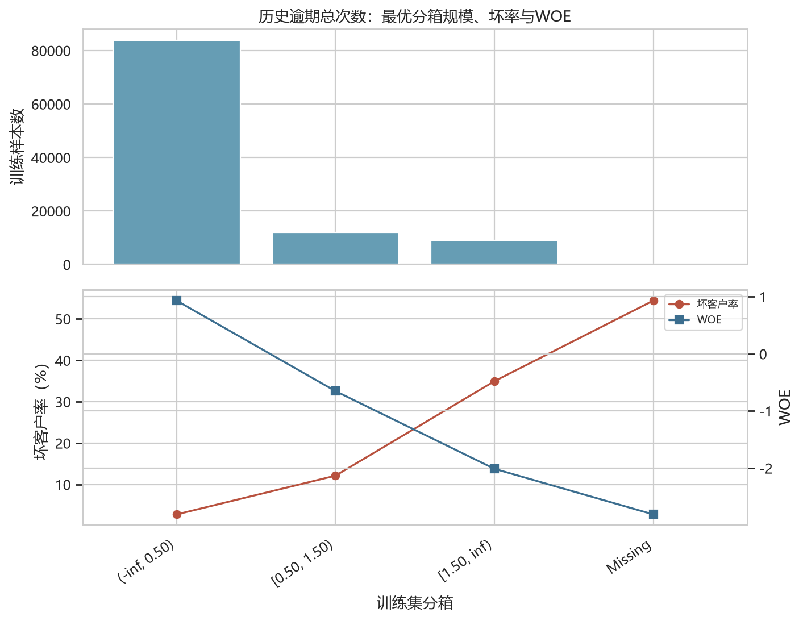

训练集有效箱共 4 个，箱坏率范围为 2.75%–54.40%；IV=1.356435，验证 PSI=0.000171。

初筛结论：高IV待复核。检查数据泄露、特殊编码和变量重复后再决定。分箱关系是统计关联，不代表因果或真实授信结论。

## 无担保循环额度使用率

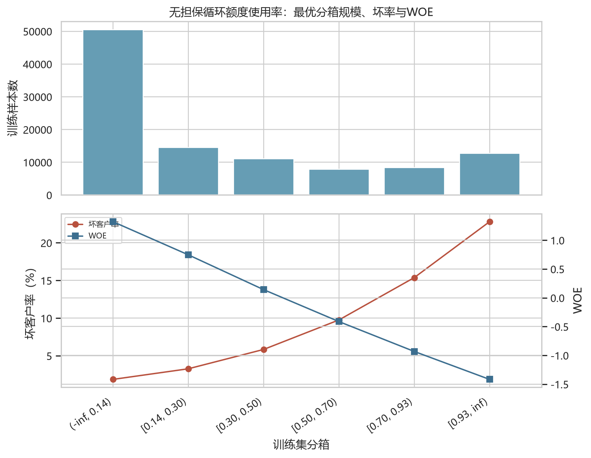

训练集有效箱共 6 个，箱坏率范围为 1.87%–22.80%；IV=1.110299，验证 PSI=0.000254。

初筛结论：高IV待复核。检查数据泄露、特殊编码和变量重复后再决定。分箱关系是统计关联，不代表因果或真实授信结论。

## 历史严重逾期标记

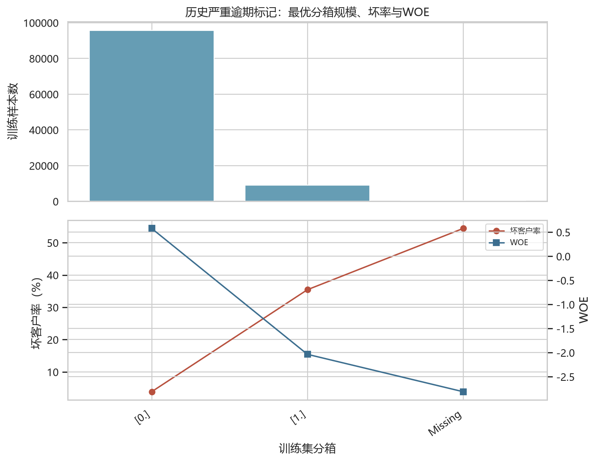

训练集有效箱共 3 个，箱坏率范围为 3.87%–54.40%；IV=1.085786，验证 PSI=0.000067。

初筛结论：高IV待复核。检查数据泄露、特殊编码和变量重复后再决定。分箱关系是统计关联，不代表因果或真实授信结论。

## 90天及以上逾期次数

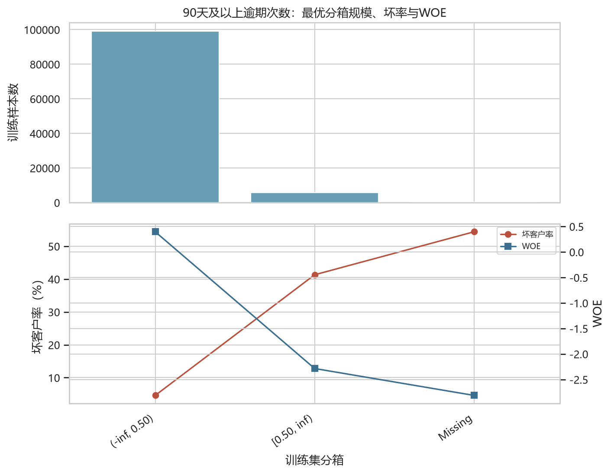

训练集有效箱共 3 个，箱坏率范围为 4.60%–54.40%；IV=0.852751，验证 PSI=0.000146。

初筛结论：高IV待复核。检查数据泄露、特殊编码和变量重复后再决定。分箱关系是统计关联，不代表因果或真实授信结论。

## 30–59天逾期次数

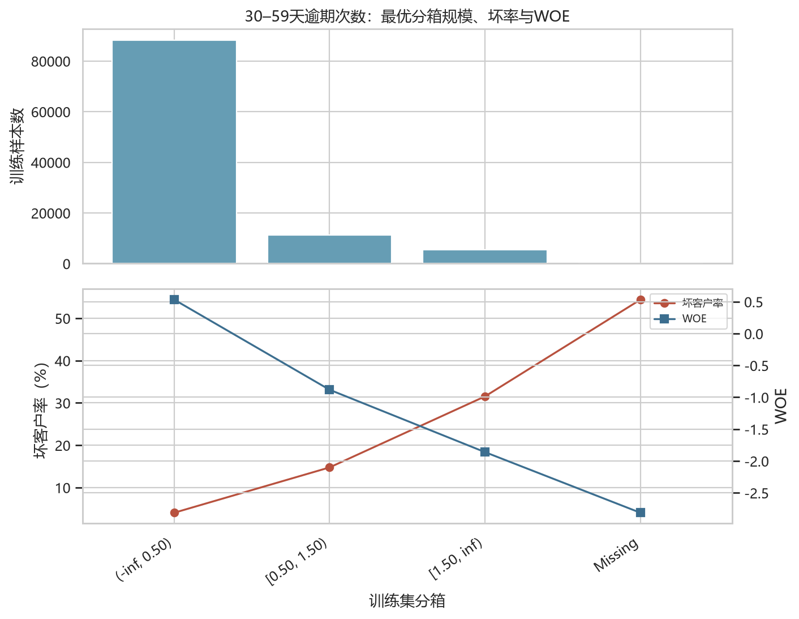

训练集有效箱共 4 个，箱坏率范围为 4.04%–54.40%；IV=0.729666，验证 PSI=0.000091。

初筛结论：高IV待复核。检查数据泄露、特殊编码和变量重复后再决定。分箱关系是统计关联，不代表因果或真实授信结论。

## 年龄

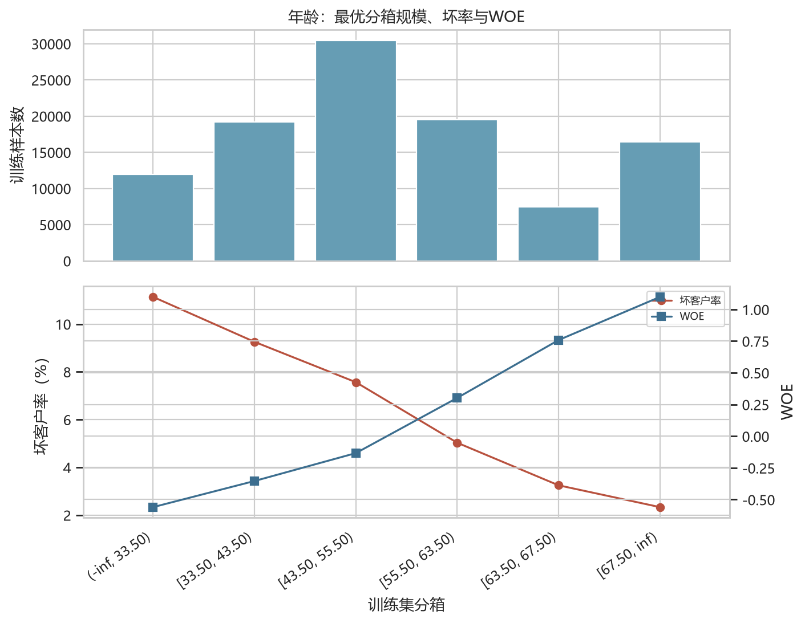

训练集有效箱共 6 个，箱坏率范围为 2.33%–11.14%；IV=0.242014，验证 PSI=0.000222。

初筛结论：阶段四候选。保留至阶段四进行VIF、系数、显著性和验证表现综合筛选。分箱关系是统计关联，不代表因果或真实授信结论。

## 人均剩余收入

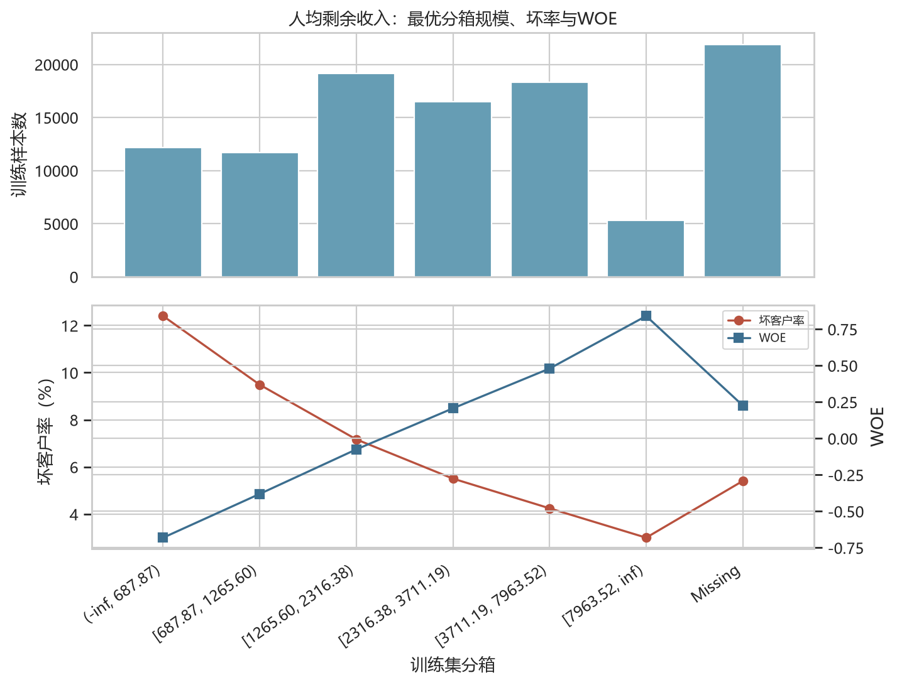

训练集有效箱共 7 个，箱坏率范围为 3.00%–12.40%；IV=0.166120，验证 PSI=0.000913。

初筛结论：阶段四候选。保留至阶段四进行VIF、系数、显著性和验证表现综合筛选。分箱关系是统计关联，不代表因果或真实授信结论。

## 人均月收入

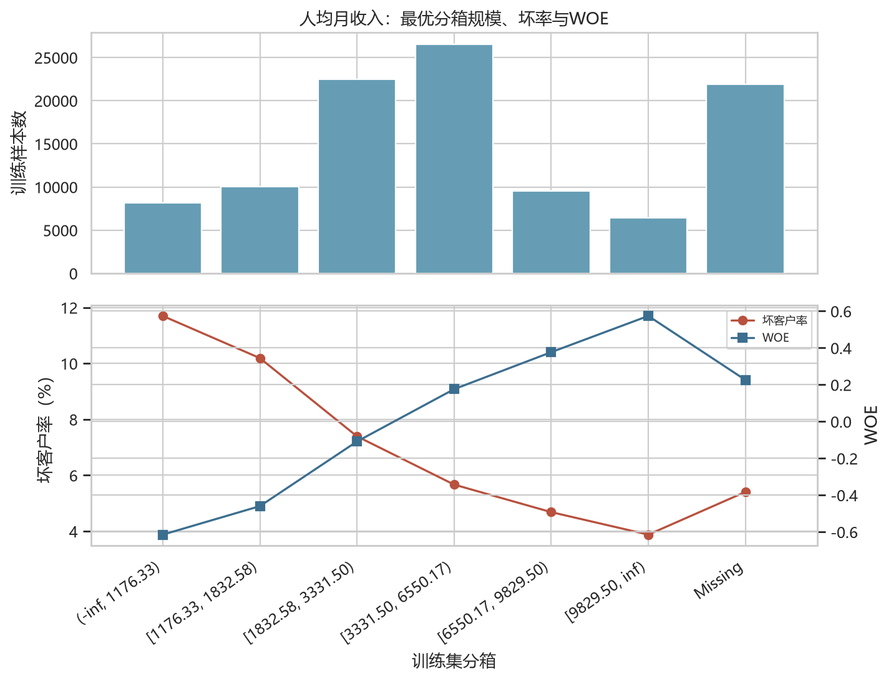

训练集有效箱共 7 个，箱坏率范围为 3.88%–11.70%；IV=0.109439，验证 PSI=0.000124。

初筛结论：阶段四候选。保留至阶段四进行VIF、系数、显著性和验证表现综合筛选。分箱关系是统计关联，不代表因果或真实授信结论。

## 房地产贷款账户占比

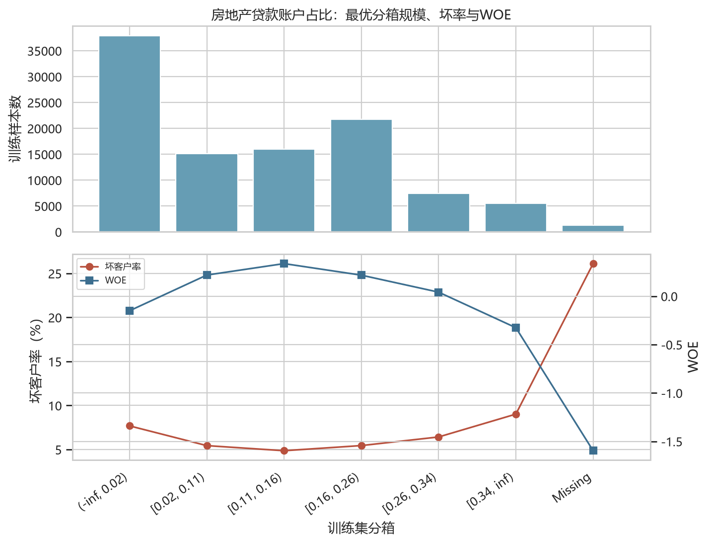

训练集有效箱共 7 个，箱坏率范围为 4.87%–26.12%；IV=0.107996，验证 PSI=0.000509。

初筛结论：阶段四候选。保留至阶段四进行VIF、系数、显著性和验证表现综合筛选。分箱关系是统计关联，不代表因果或真实授信结论。

## 开放信贷账户数

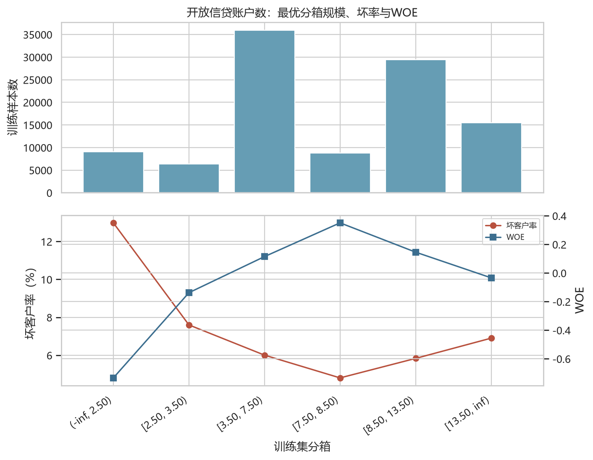

训练集有效箱共 6 个，箱坏率范围为 4.80%–12.98%；IV=0.083954，验证 PSI=0.000228。

初筛结论：阶段四候选。保留至阶段四进行VIF、系数、显著性和验证表现综合筛选。分箱关系是统计关联，不代表因果或真实授信结论。

## 债务比率

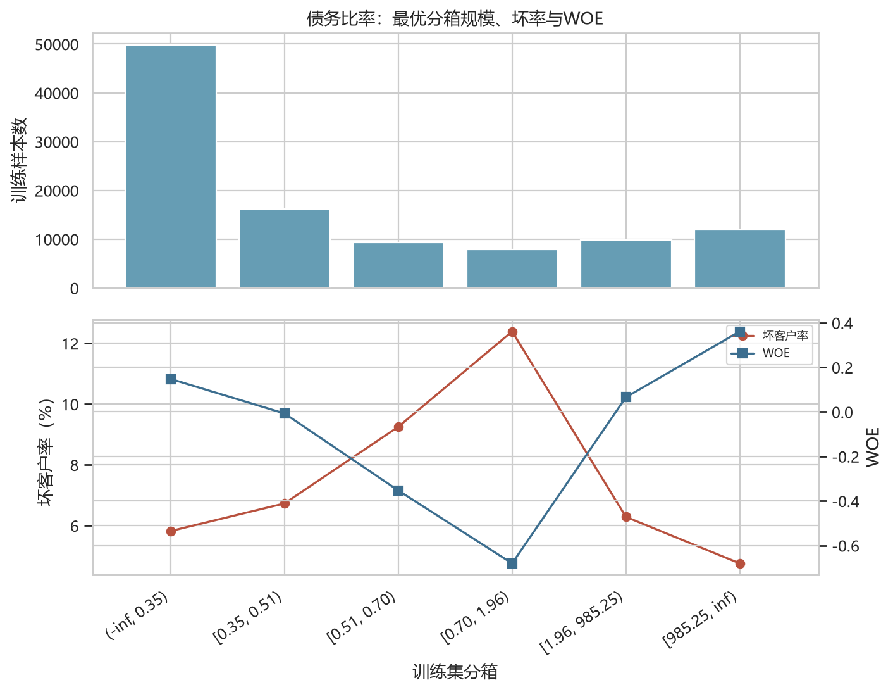

训练集有效箱共 6 个，箱坏率范围为 4.76%–12.39%；IV=0.082663，验证 PSI=0.000688。

初筛结论：阶段四候选。保留至阶段四进行VIF、系数、显著性和验证表现综合筛选。分箱关系是统计关联，不代表因果或真实授信结论。

## 月收入

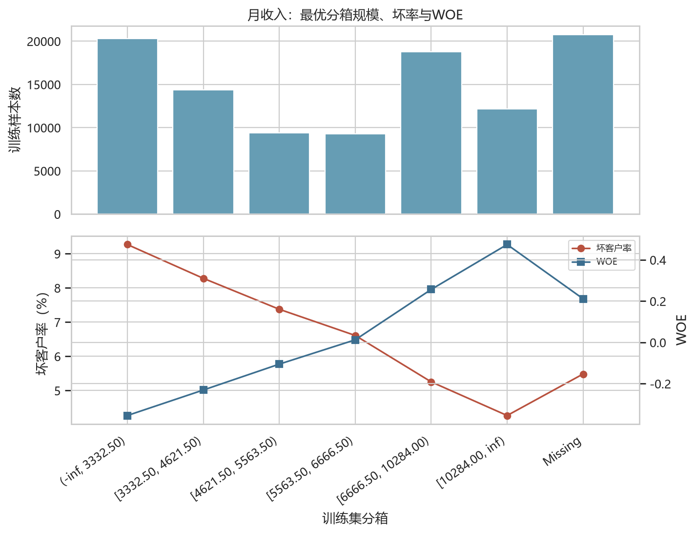

训练集有效箱共 7 个，箱坏率范围为 4.27%–9.27%；IV=0.077373，验证 PSI=0.000408。

初筛结论：阶段四候选。保留至阶段四进行VIF、系数、显著性和验证表现综合筛选。分箱关系是统计关联，不代表因果或真实授信结论。

## 房地产贷款或额度数

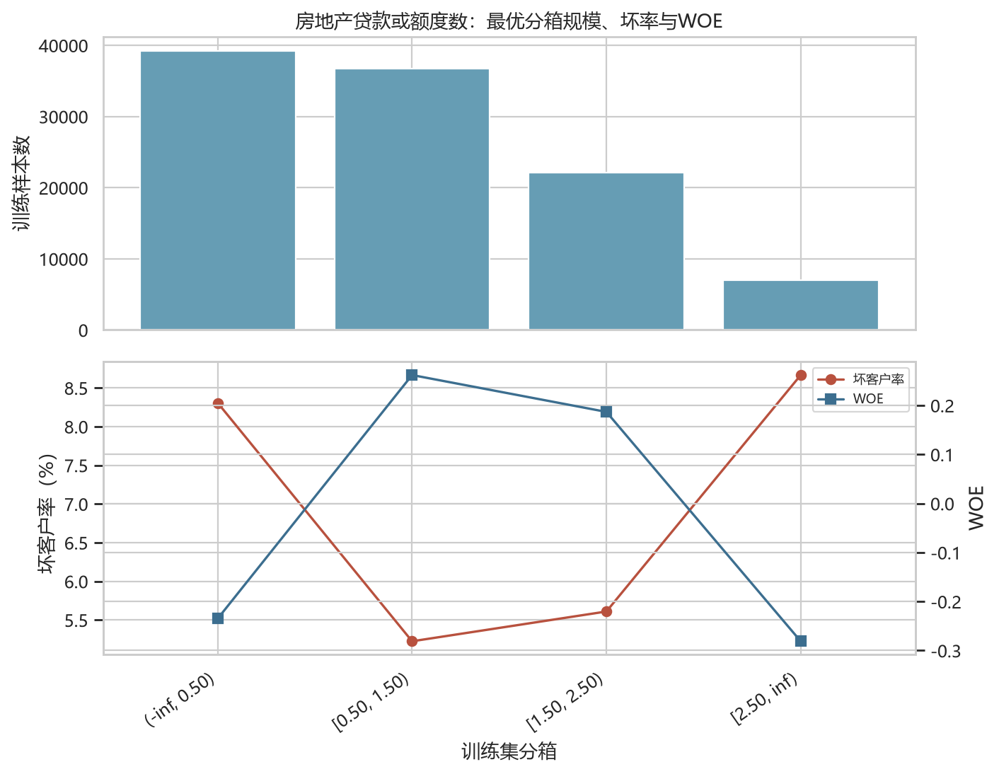

训练集有效箱共 4 个，箱坏率范围为 5.22%–8.67%；IV=0.056907，验证 PSI=0.000363。

初筛结论：阶段四候选。保留至阶段四进行VIF、系数、显著性和验证表现综合筛选。分箱关系是统计关联，不代表因果或真实授信结论。

## 60–89天逾期次数

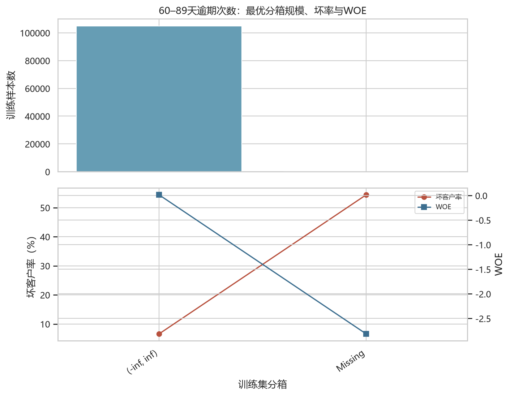

训练集有效箱共 2 个，箱坏率范围为 6.60%–54.40%；IV=0.037471，验证 PSI=0.000066。

初筛结论：阶段四候选。保留至阶段四进行VIF、系数、显著性和验证表现综合筛选。分箱关系是统计关联，不代表因果或真实授信结论。

## 家属人数

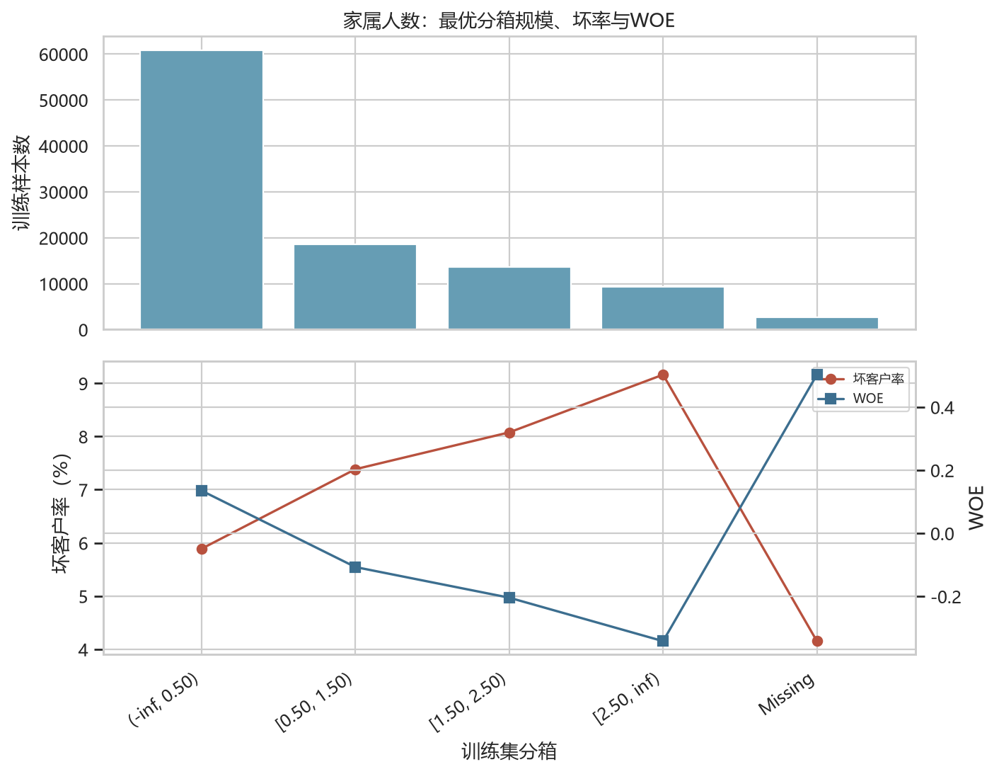

训练集有效箱共 5 个，箱坏率范围为 4.15%–9.16%；IV=0.035388，验证 PSI=0.000095。

初筛结论：阶段四候选。保留至阶段四进行VIF、系数、显著性和验证表现综合筛选。分箱关系是统计关联，不代表因果或真实授信结论。

## 估算月债务

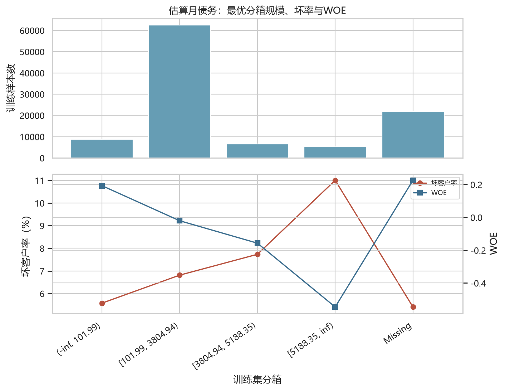

训练集有效箱共 5 个，箱坏率范围为 5.40%–11.00%；IV=0.033430，验证 PSI=0.000092。

初筛结论：阶段四候选。保留至阶段四进行VIF、系数、显著性和验证表现综合筛选。分箱关系是统计关联，不代表因果或真实授信结论。

## 月收入原始缺失标记

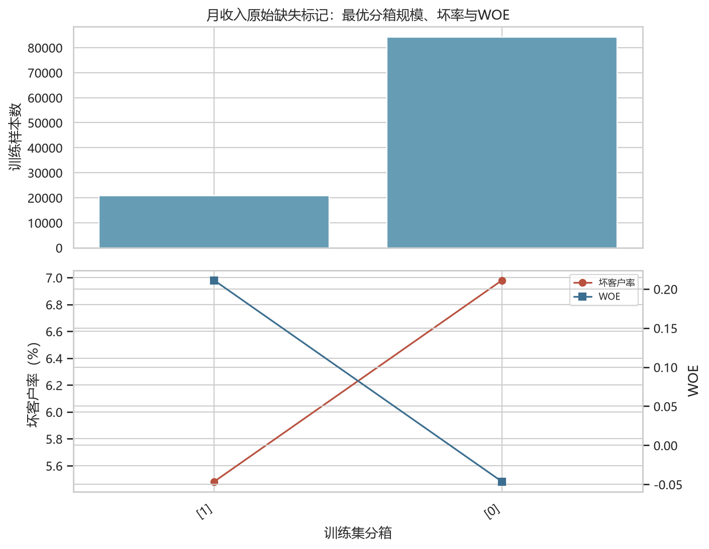

训练集有效箱共 2 个，箱坏率范围为 5.48%–6.98%；IV=0.009794，验证 PSI=0.000041。

初筛结论：弱变量。单变量IV低，不推荐直接进入阶段四。分箱关系是统计关联，不代表因果或真实授信结论。

## 家属人数原始缺失标记

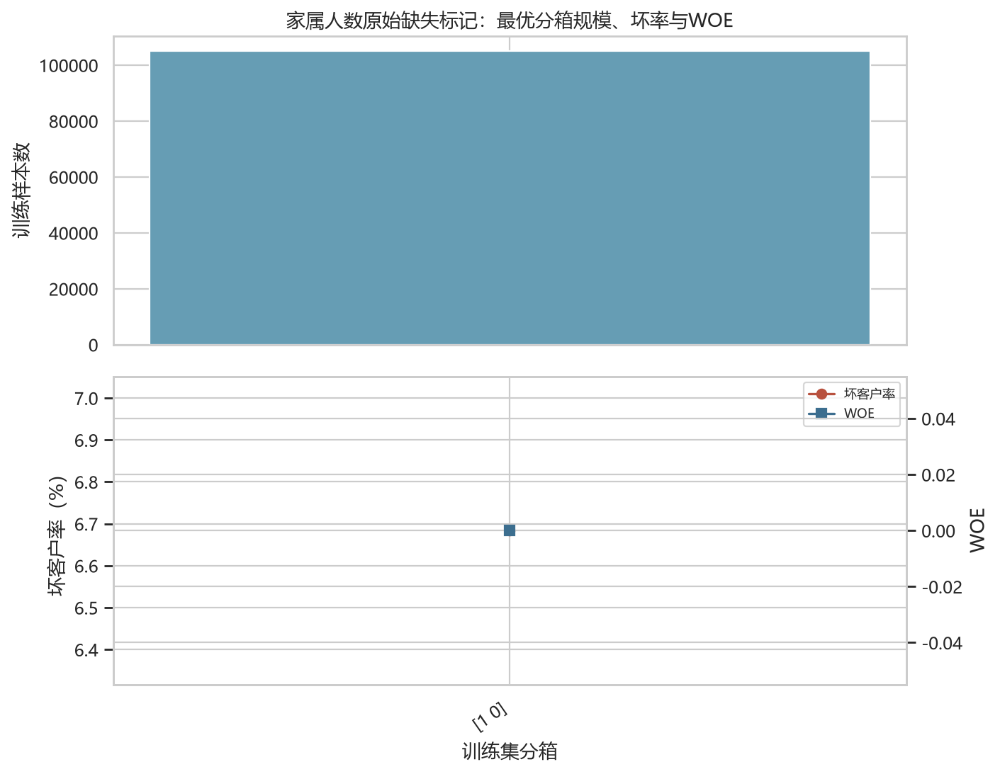

训练集有效箱共 1 个，箱坏率范围为 6.68%–6.68%；IV=0.000000，验证 PSI=0.000000。

初筛结论：弱变量。单变量IV低，不推荐直接进入阶段四。分箱关系是统计关联，不代表因果或真实授信结论。

## 逾期96/98特殊编码标记

训练集有效箱共 1 个，箱坏率范围为 6.68%–6.68%；IV=0.000000，验证 PSI=0.000000。

初筛结论：弱变量。单变量IV低，不推荐直接进入阶段四。分箱关系是统计关联，不代表因果或真实授信结论。
