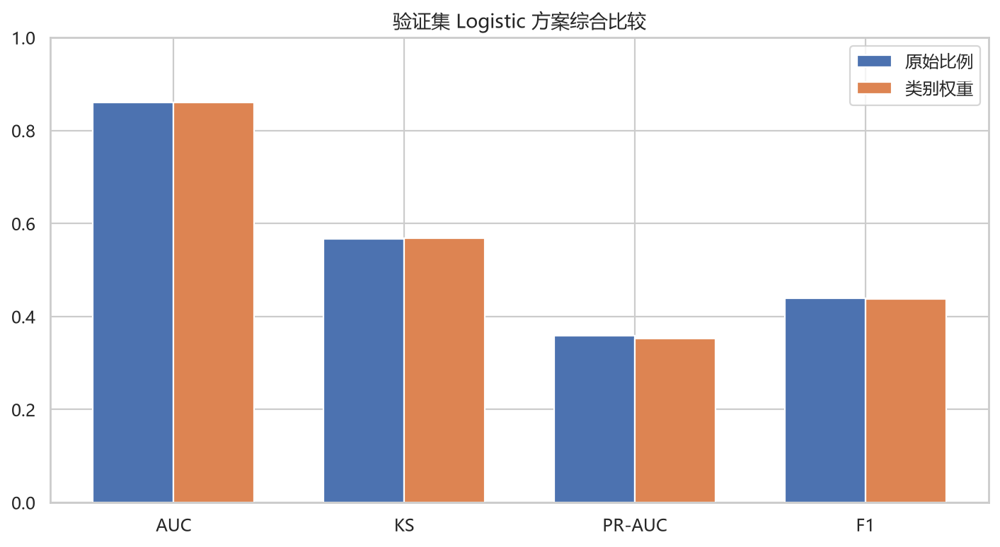
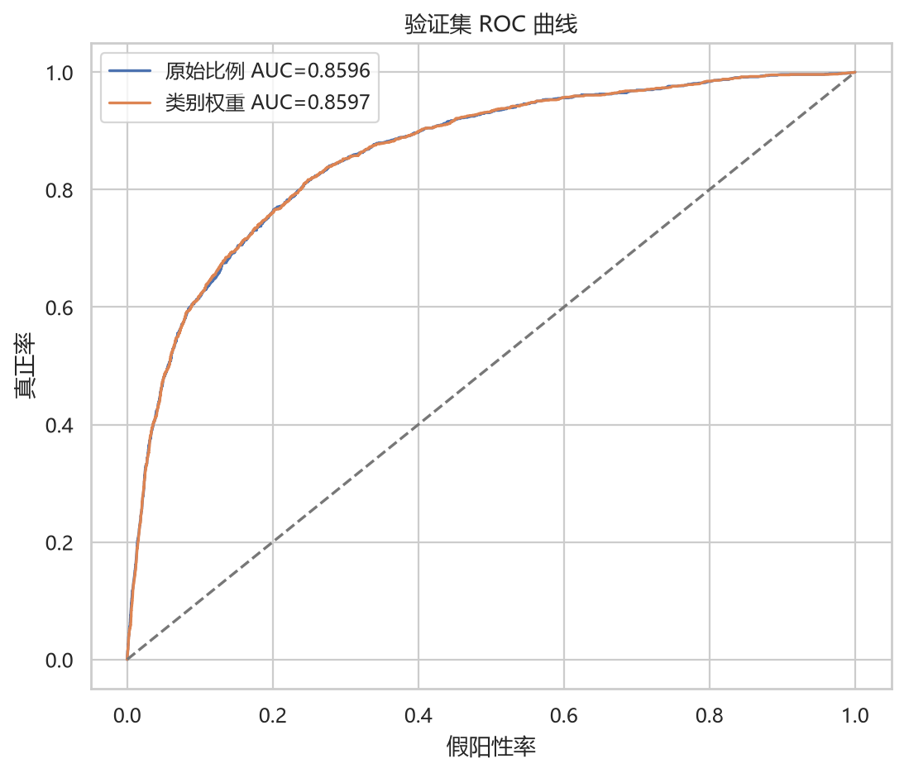
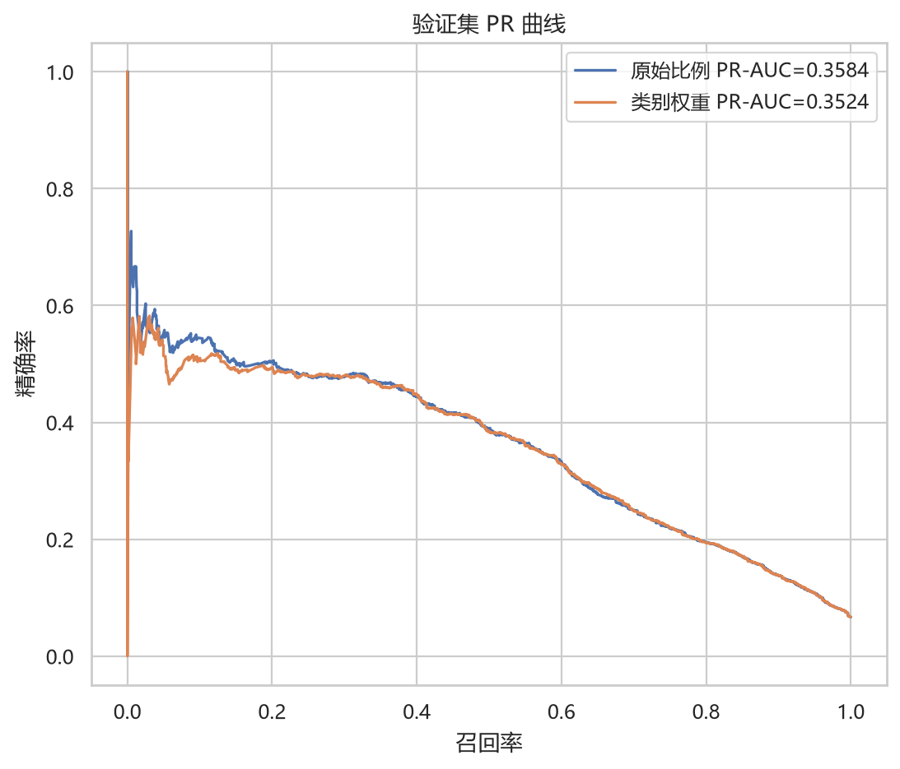
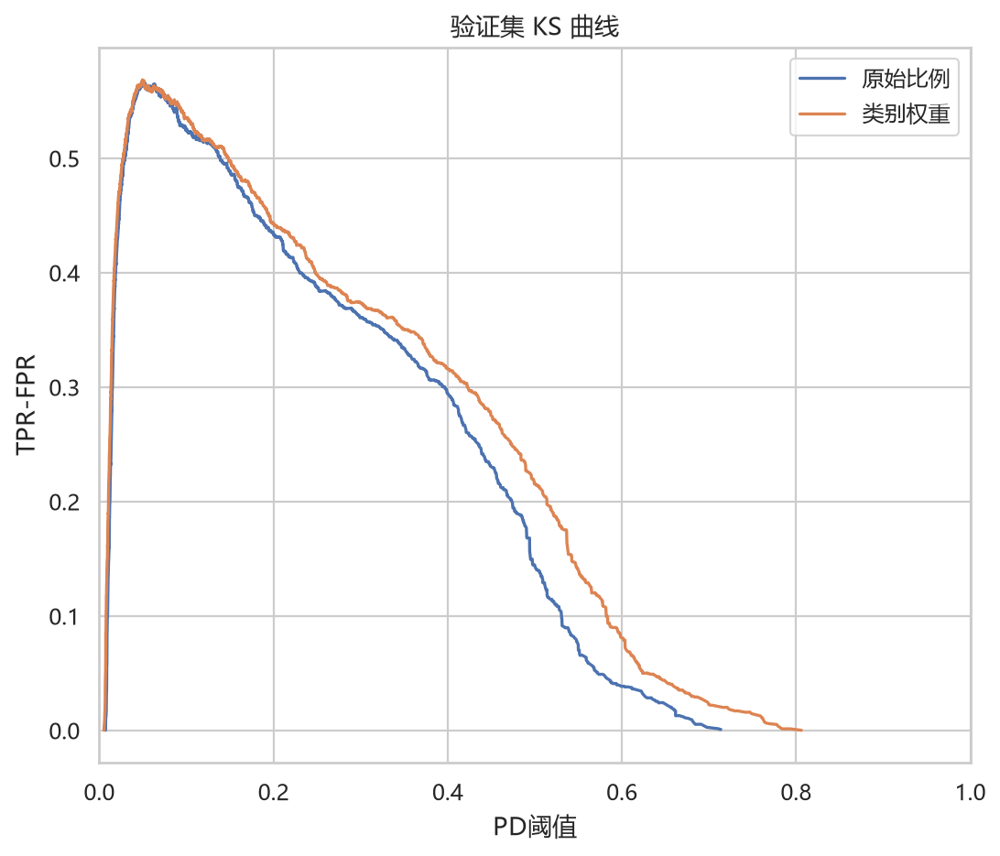
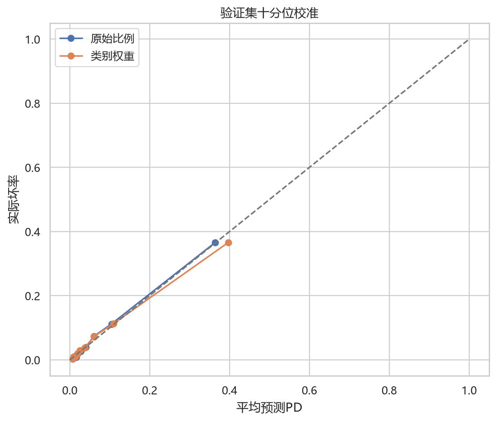
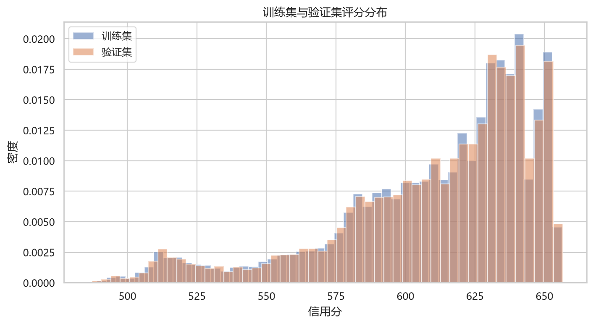
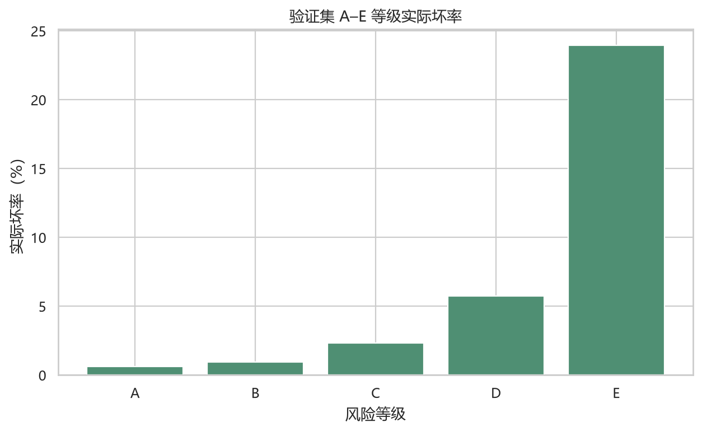
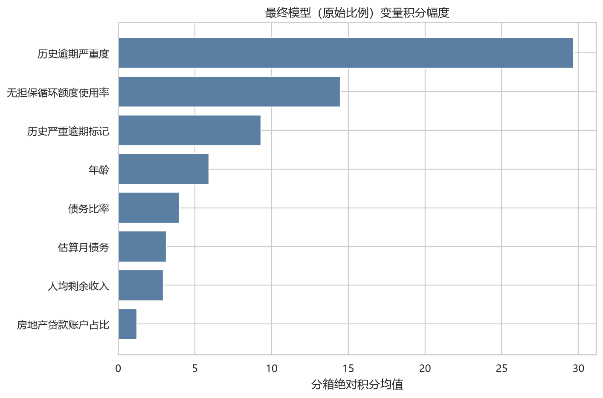

# GMSC 第四阶段 Logistic 与信用评分卡说明

变量筛选、交叉验证和参数搜索只使用训练集；验证集只用于候选方案选择。测试集标签未读取。
本项目预测未来两年严重逾期概率，仅用于教学研究，不代表真实授信审批结论。

## 最终方案

最终选择“原始比例”方案，入模变量 8 个：无担保循环额度使用率、年龄、债务比率、历史严重逾期标记、历史逾期严重度、房地产贷款账户占比、估算月债务、人均剩余收入。

验证集 AUC=0.859586，KS=0.566737，PR-AUC=0.358407，F1=0.438348，Brier=0.050267，Log Loss=0.181606。

校准截距=0.030215，校准斜率=1.011251；校准门槛判定=通过。

## 方案综合比较

## ROC

## PR

## KS

## 概率校准

## 评分分布

## 风险等级

## 变量积分

## A–E 等级验证结果

- A级：4,539 人，平均分 647.56，平均PD 0.96%，实际坏率 0.62%。
- B级：4,467 人，平均分 635.14，平均PD 1.47%，实际坏率 0.94%。
- C级：4,555 人，平均分 621.14，平均PD 2.39%，实际坏率 2.31%。
- D级：4,452 人，平均分 599.06，平均PD 5.05%，实际坏率 5.73%。
- E级：4,487 人，平均分 553.73，平均PD 23.44%，实际坏率 23.94%。

等级边界来自训练集等频分位数，验证集结果未用于调整边界。