# GMSC 第五阶段 Random Forest、XGBoost 与 SHAP 说明

Logistic 评分卡保持主模型地位；Random Forest 与 XGBoost 是对照和挑战者。所有调参、缺失值规则、阈值和早停轮数仅来自训练集。
验证集用于冻结比较结论；测试集只在冻结后进行一次审计，未参与选模或返工调参。
本项目只预测未来两年严重逾期概率，不代表真实授信审批结论。

## 验证集结论

最佳树模型挑战者：XGBoost。Logistic 评分卡仍是项目主路线。

- Logistic 评分卡：AUC=0.859586，KS=0.566737，PR-AUC=0.358407，F1=0.438348，Brier=0.050267，Log Loss=0.181606，校准门槛=通过，预测 PSI=0.000203。
- Random Forest：AUC=0.869517，KS=0.589998，PR-AUC=0.399148，F1=0.450289，Brier=0.048800，Log Loss=0.176034，校准门槛=未通过，预测 PSI=0.000471。
- XGBoost：AUC=0.869582，KS=0.586988，PR-AUC=0.406017，F1=0.451205，Brier=0.048457，Log Loss=0.175316，校准门槛=通过，预测 PSI=0.001841。

## 测试集冻结后审计

- XGBoost：AUC=0.862965，KS=0.569926，PR-AUC=0.403907，F1=0.438171，Brier=0.048957，Log Loss=0.177994。
- Random Forest：AUC=0.860755，KS=0.567962，PR-AUC=0.399850，F1=0.433410，Brier=0.049260，Log Loss=0.179101。
- Logistic 评分卡：AUC=0.854451，KS=0.561071，PR-AUC=0.356227，F1=0.435959，Brier=0.050682，Log Loss=0.183797。

测试集结果仅用于报告泛化表现，不改变任何模型、阈值或验证集结论。

## 验证集综合指标

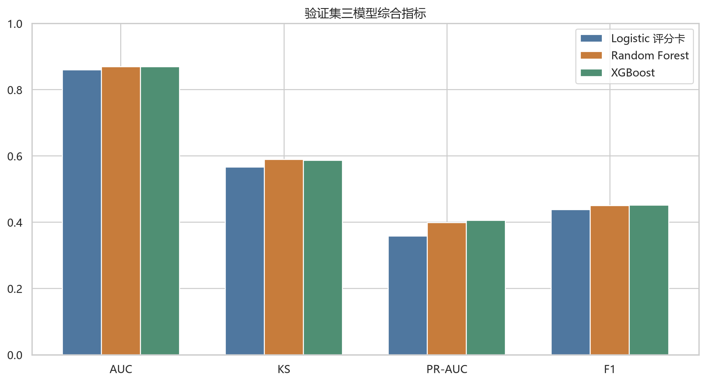

## 验证集 ROC

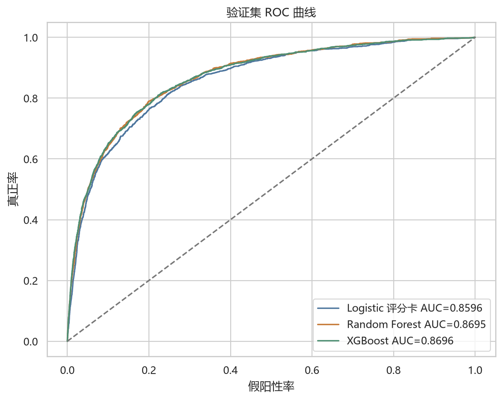

## 验证集 PR

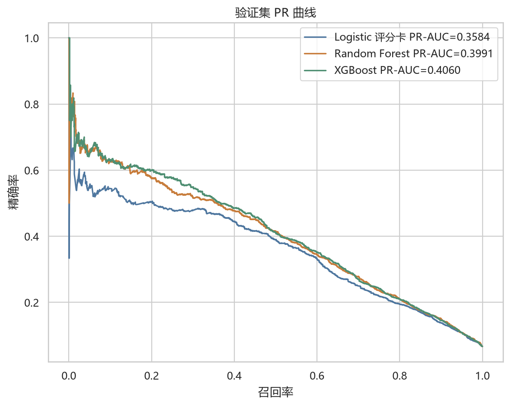

## 验证集 KS

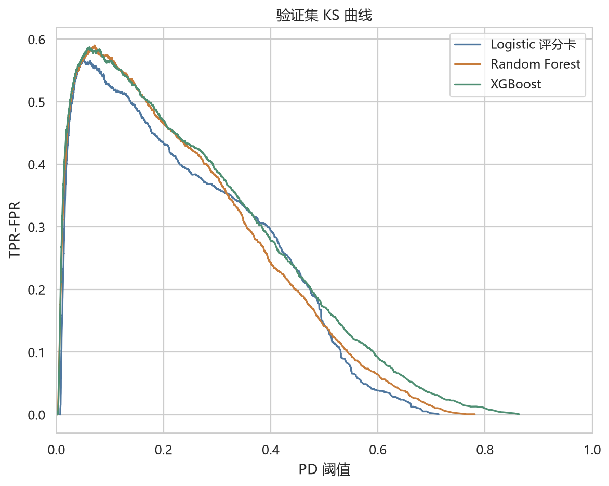

## 验证集概率校准

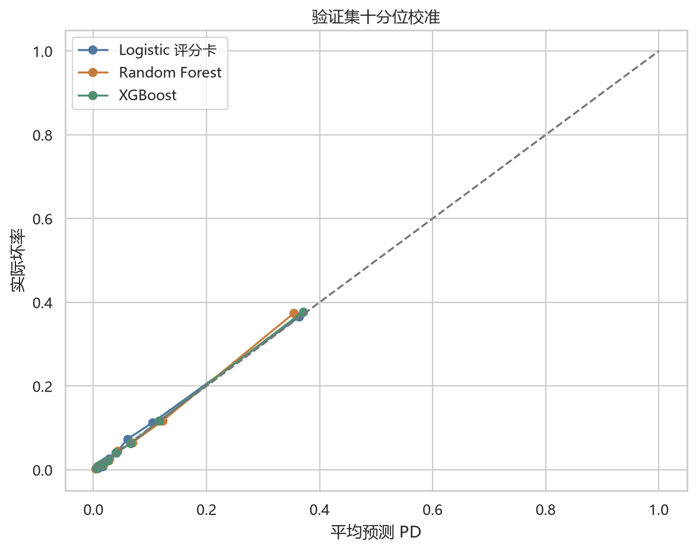

## 模型复杂度

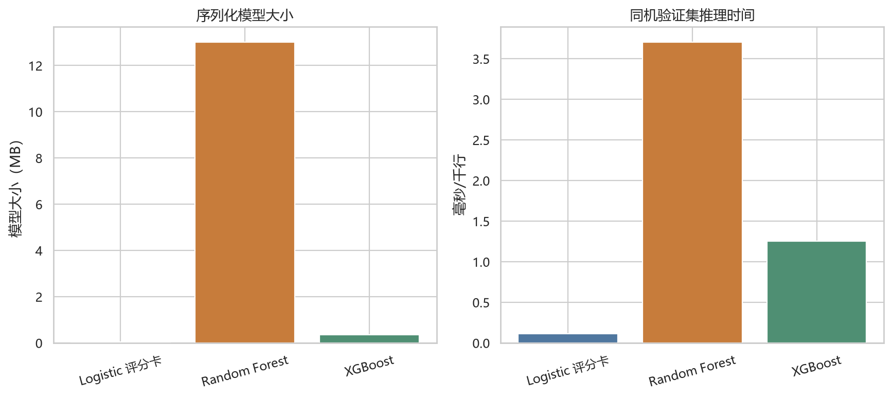

## Random Forest 特征重要性

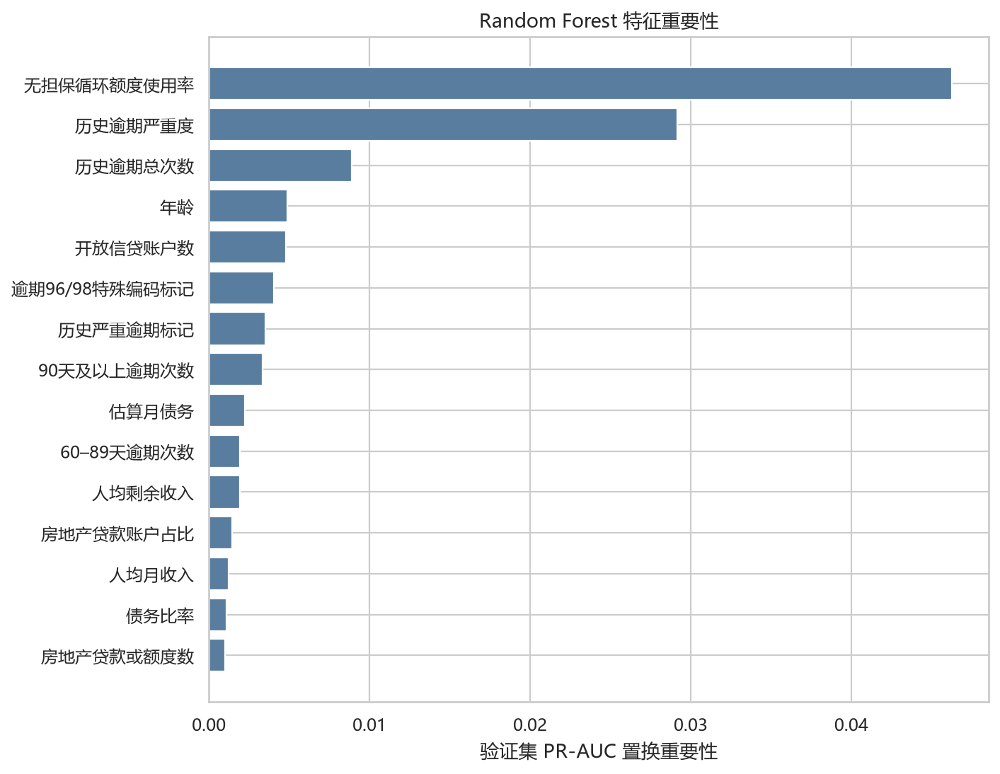

## XGBoost 特征重要性

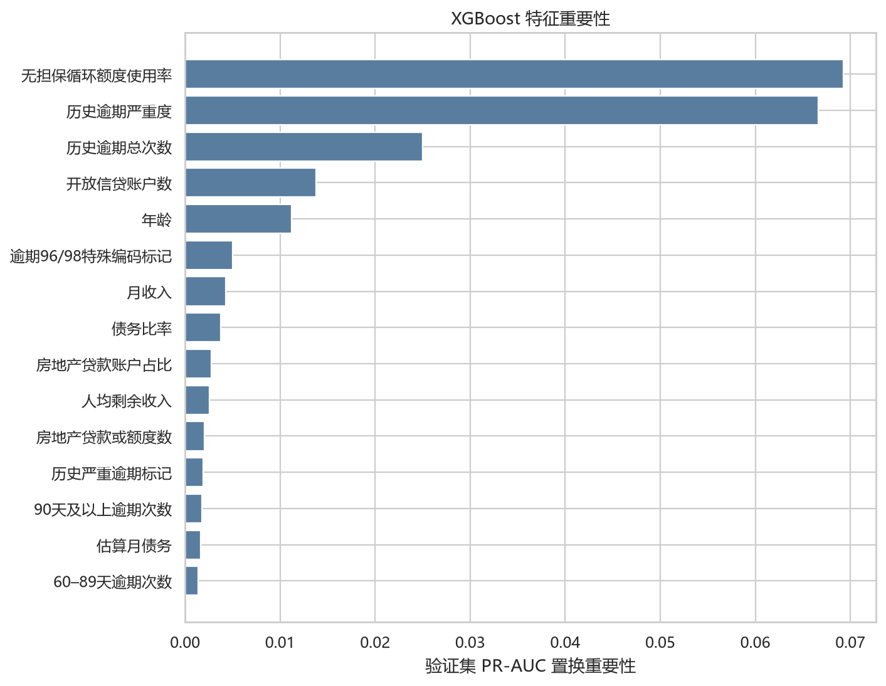

## Random Forest SHAP

### 全局重要性

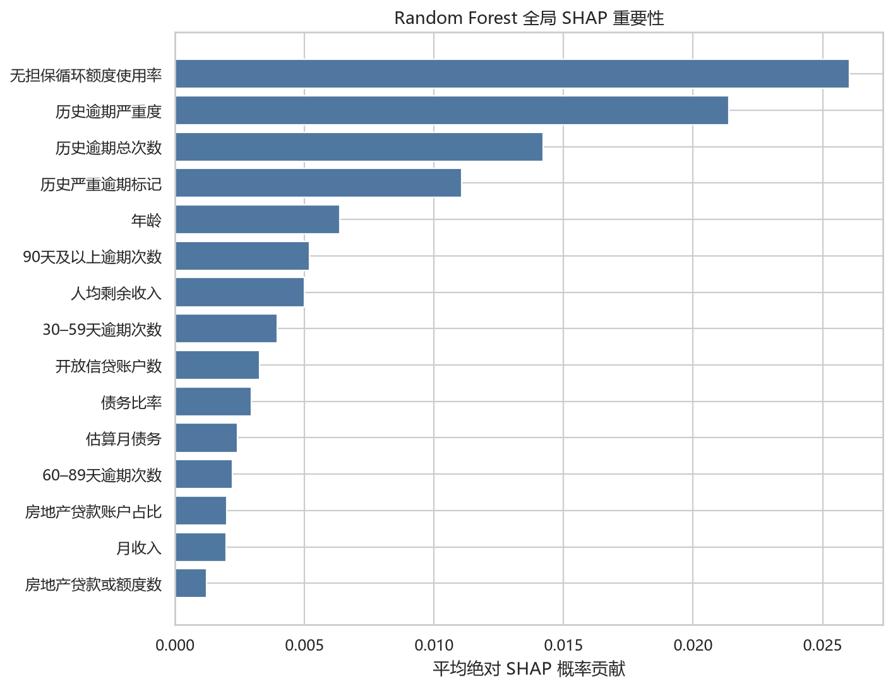

### 影响方向

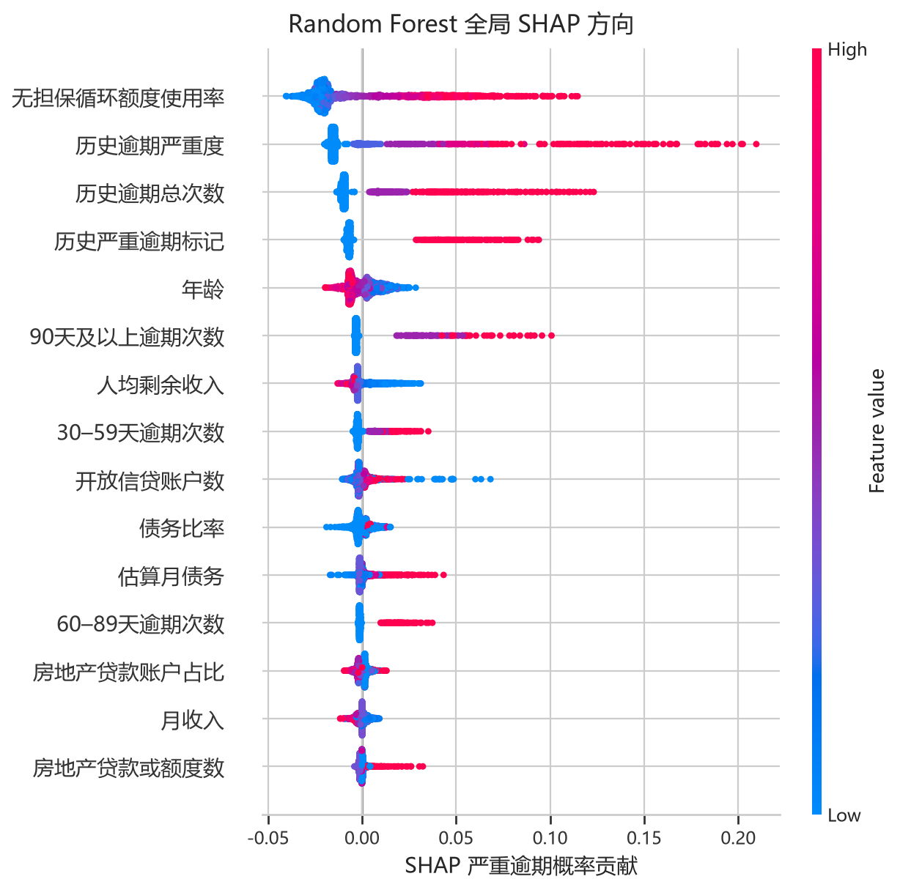

## XGBoost SHAP

### 全局重要性

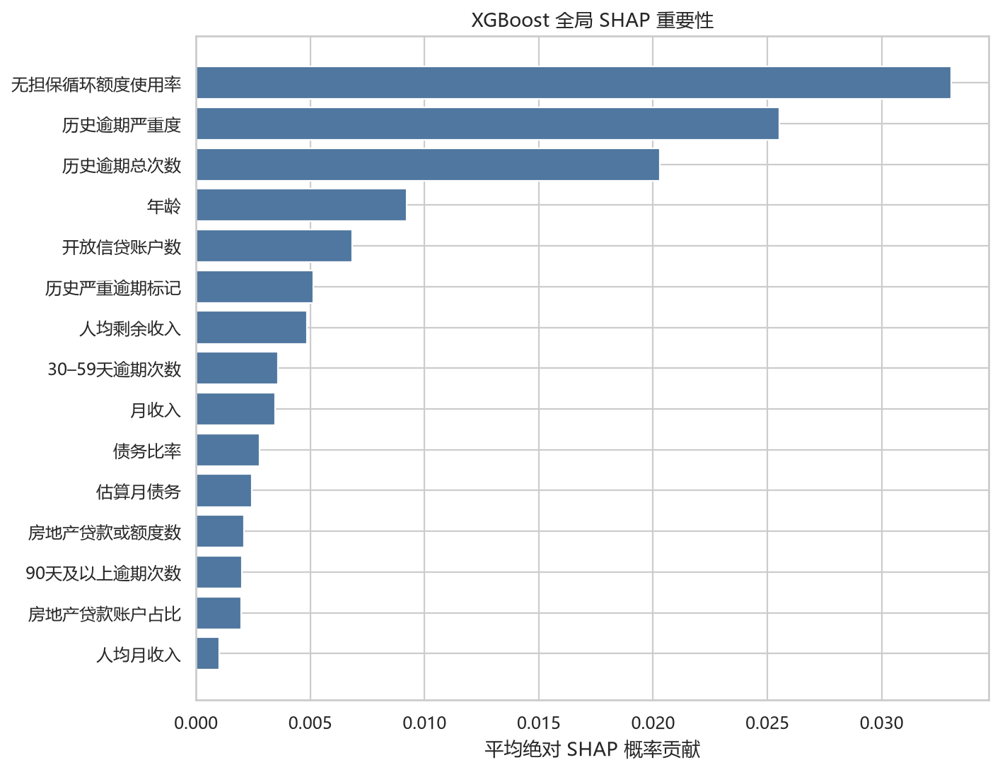

### 影响方向

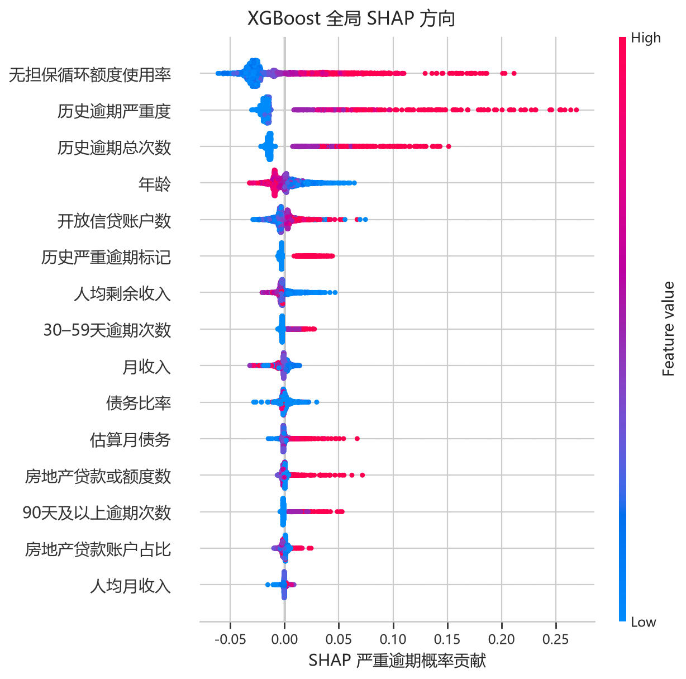

## 解释口径

SHAP 使用 interventional 特征扰动并解释严重逾期概率；基准概率与各特征 SHAP 贡献之和等于模型 PD。
个案来自验证集低风险、中位风险、高风险以及两树模型分歧最大的固定客户，选择过程不使用真实标签。